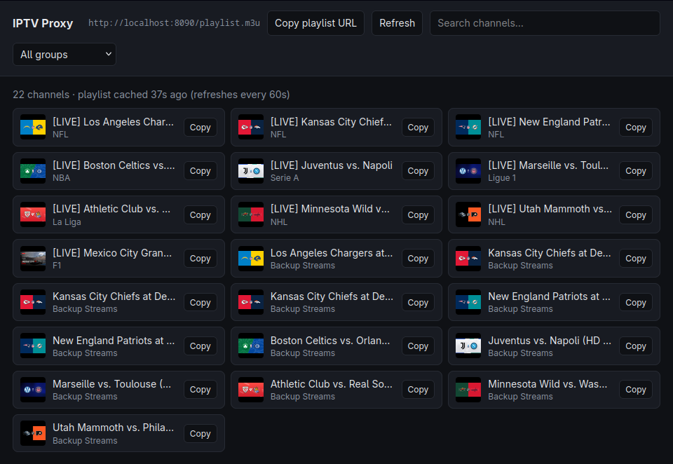

<div align="center">

# OnDemand IPTV

**A self-hosted IPTV playlist proxy for the OnDemand IPTV Service.**

One tiny Go binary that fetches your M3U playlist, rewrites every stream URL
to flow through it, repairs the quirks that make players choke — and serves a
clean channel grid you can watch right in the browser.

[](https://go.dev)
[](#-license)
[](#-how-it-works)
[](#-quick-start)



</div>

---

## Why OnDemand IPTV?

If you self-host IPTV, you know the pain: your provider hands you an `m3u`
whose URLs only work with specific headers, break in VLC or `mpv` because the
segments are disguised as images, and leak the upstream provider (and its
token) to every device you load the playlist on.

**ondemand-iptv-proxy sits in the middle.** Your player only ever sees your server.
ondemand-iptv-proxy fetches the upstream playlist, rewrites every URL — variants,
segments, encryption keys, alternate audio tracks — into proxied paths,
forwards the right headers, and patches up broken streams on the fly. Change
providers once, in one environment variable; nothing on the player side ever
changes.

## ✨ Features

- **🔬 Zero dependencies** — pure Go standard library, single static binary (~5 MB), web UI embedded via `go:embed`.
- **🔁 Full playlist rewriting** — understands HLS and M3U structures: `#EXT-X-STREAM-INF` variants, media segments, `#EXT-X-MAP` init sections, `#EXT-X-KEY` decryption keys, `#EXT-X-MEDIA` alternate audio and I-frame playlists. Nested playlists are detected by content sniffing and rewritten recursively.
- **🩹 MPEG-TS repair** — detects segments that are really TS data behind a fake `.png`/`.webp` extension, locates the first valid sync byte (`0x47` + two more at +188/+376), strips the junk prefix, fixes `Content-Length` and reports an honest `video/mp2t` type. Fixes "invalid data" errors in `mpv`, VLC and ffmpeg.
- **🏷️ Honest file extensions** — proxied URLs get the extension players expect (`.m3u8` for variants, `.ts` for segments, `.key` for keys), instead of whatever the upstream guessed.
- **⚡ Caching with stale fallback** — the playlist is cached with a configurable TTL; if the upstream hiccups, you still get the last good copy instead of a dead playlist.
- **🖥️ Built-in web UI** — responsive dark-themed channel grid with live search, group filters, lazy-loaded logos, in-browser HLS playback (via hls.js, with native fallback), one-click copy of stream URLs and the playlist URL.
- **📡 Player-agnostic** — the rewritten `playlist.m3u` is a standard M3U; point VLC, `mpv`, ffmpeg, TiviMate, Kodi or any smart-TV app at it.
- **🧭 Reverse-proxy friendly** — auto-detects scheme/host from `X-Forwarded-Proto`, or pin it with `PUBLIC_BASE`. Honors `HTTP_PROXY`/`HTTPS_PROXY` for upstream egress.

## 🚀 Quick start

### From source

```bash
git clone https://github.com/Lunatic16/ondemand-iptv-proxy.git
cd ondemand-iptv-proxy
go build -o ondemand-iptv-proxy .

UPSTREAM_URL="https://your-provider.example/playlist.m3u?token=YOUR_TOKEN" ./ondemand-iptv-proxy
# listening on :8080 (playlist TTL 1m0s)
```

Open **http://localhost:8080** for the web UI, or hand
`http://your-host:8080/playlist.m3u` to any player.

### With Docker

```bash
docker compose up -d
```

`docker-compose.yml` ships with all environment variables pre-wired — edit the
`environment:` block and you're done. The final image is built `FROM scratch`
and lands **under 6 MB**.

## ⚙️ Configuration

Everything is configured through environment variables — no config files.

| Variable       | Default                          | Description                                                                                                                                     |
| -------------- | -------------------------------- | ----------------------------------------------------------------------------------------------------------------------------------------------- |
| `UPSTREAM_URL` | *(demo endpoint — set your own)* | Full URL of the upstream `m3u`/`m3u8` playlist. Required.                                                                                        |
| `UPSTREAM_UA`  | Safari-style `Mozilla/5.0 …`     | `User-Agent` sent to the upstream for **all** playlist and stream requests. Set this if your provider rejects unknown clients.                   |
| `PLAYLIST_TTL` | `60`                             | Playlist cache lifetime **in seconds**. Lower = fresher EPG/channel data; higher = fewer upstream hits.                                          |
| `PORT`         | `8080`                           | HTTP listen port.                                                                                                                               |
| `PUBLIC_BASE`  | *(auto-detect)*                  | Public origin used when rewriting URLs, e.g. `https://tv.example.com`. Leave empty to derive from the request's `Host` + `X-Forwarded-Proto`.    |

> **Tip:** if you run ondemand-iptv-proxy behind nginx/Caddy/Traefik, set `PUBLIC_BASE`
> to the public URL so rewritten stream URLs point at the proxy, not at an
> internal address.

## 🔌 Endpoints

| Path                 | Method | Description                                              |
| -------------------- | ------ | -------------------------------------------------------- |
| `/`                  | GET    | Web UI (embedded, single page)                            |
| `/playlist.m3u`      | GET    | Upstream playlist with all URLs rewritten to this proxy   |
| `/playlist.m3u8`     | GET    | Alias of `/playlist.m3u` (HLS-friendly name)              |
| `/s/{id}`            | GET    | Proxied stream: playlists are re-rewritten, media is piped through |
| `/api/channels`      | GET    | JSON: channel list + playlist URL + cache age/TTL         |
| `/api/refresh`       | POST   | Invalidate the playlist cache and re-fetch                |
| `/healthz`           | GET    | Liveness probe, returns `ok`                              |

<details>
<summary><code>GET /api/channels</code> response shape</summary>

```json
{
  "playlist": "http://localhost:8080/playlist.m3u",
  "age_seconds": 12,
  "ttl_seconds": 60,
  "channels": [
    {
      "name": "Aurora News HD",
      "group": "News",
      "logo": "https://…/logo.png",
      "url": "http://localhost:8080/s/aHR0cHM6Ly9…"
    }
  ]
}
```

</details>

## 🧠 How it works

```text
   ┌──────────────┐   playlist.m3u      ┌────────────────────┐
   │ your player  │◄────────────────────│    ondemand-iptv-proxy     │
   │ (VLC, mpv,   │   /s/<base64-url>   │  · fetch + cache   │────► upstream
   │ Kodi, web UI)│────────────────────►│  · rewrite URLs    │      provider
   └──────────────┘   every segment &   │  · repair streams  │────► upstream
                      key flows through │  · forward headers │      streams
                                        └────────────────────┘
```

**Playlist rewriting.** Every URL in the upstream playlist is resolved against
its base, base64url-encoded, and replaced with a `/s/<id>` path on your
server. Attribute URIs (`URI="…"` on keys, maps and alternate renditions) are
rewritten in place, so nothing escapes the proxy — your player never learns
the upstream host.

**Stream proxying.** `/s/` decodes the target, forwards your `Range` header,
applies the configured `User-Agent`, and streams the response with chunked
flushing (long-lived connections are fine — there is no write timeout). If
the response is itself a playlist, it is rewritten recursively.

**TS repair.** When a "segment" arrives with a bogus image content type or a
junk prefix before the MPEG-TS data, ondemand-iptv-proxy scans for a valid TS sync
pattern (`0x47` at offsets *i*, *i+188*, *i+376*), discards everything before
it, and adjusts the headers. Your player just sees clean video.

## 🐳 Docker

<details>
<summary>Dockerfile (multi-stage, scratch-based)</summary>

```dockerfile
FROM golang:1.23-alpine AS build
WORKDIR /src
COPY go.mod main.go index.html ./
RUN CGO_ENABLED=0 go build -trimpath -ldflags="-s -w" -o /iptvproxy .

FROM scratch
COPY --from=build /etc/ssl/certs/ca-certificates.crt /etc/ssl/certs/
COPY --from=build /iptvproxy /iptvproxy
EXPOSE 8080
USER 65534:65534
ENTRYPOINT ["/iptvproxy"]
```

</details>

<details>
<summary>docker-compose.yml</summary>

```yaml
services:
  iptvproxy:
    build: .
    container_name: ondemand-iptvproxy
    restart: unless-stopped
    ports:
      - "8090:8080"
    environment:
      # Address TiviMate uses to reach this box (LAN IP or hostname)
      #PUBLIC_BASE: "http://localhost:8090"
      UPSTREAM_URL: "https://ondemand.st/papi/iptv/playlist.m3u?token=dami2026live"
      UPSTREAM_UA: "Mozilla/5.0 OnDemandIPTV AppleWebKit/605.1.15 (KHTML, like Gecko) Version/17.5 Safari/604.1"
      PLAYLIST_TTL: "60"   # seconds between upstream playlist refreshes
```

</details>

## 🛡️ Notes & responsible use

- ondemand-iptv-proxy is a **caching reverse proxy for playlists you already have
  access to**. It ships with no content and no default provider — point it at
  streams you are authorized to use, and respect your provider's terms and
  your local law.
- The server has **no built-in authentication**. Anyone who can reach it can
  watch through it. Keep it on your LAN/VPN, or put authentication in front of
  it before exposing it to the internet.
- Upstream 403s? Try adjusting `UPSTREAM_UA` — many providers whitelist
  specific client user agents.
- The web UI renders the first **1,000** matching channels; use the search box
  or group filter to narrow large playlists.

## 🤝 Contributing

Issues and pull requests are welcome. For non-trivial changes, please open an
issue first to discuss what you'd like to change.

## 📄 License

Released under the [MIT License](LICENSE).
